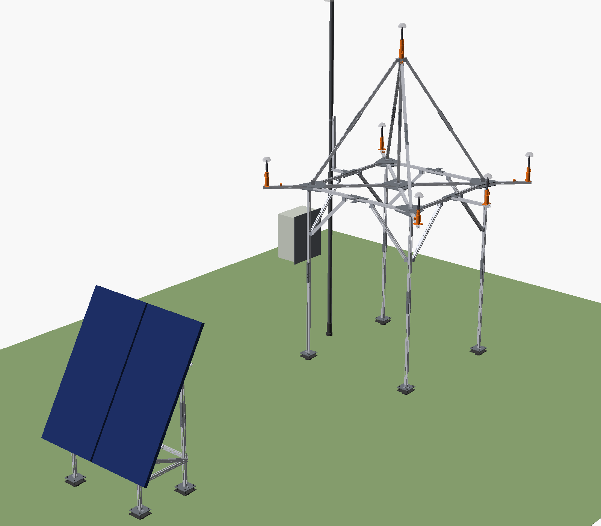
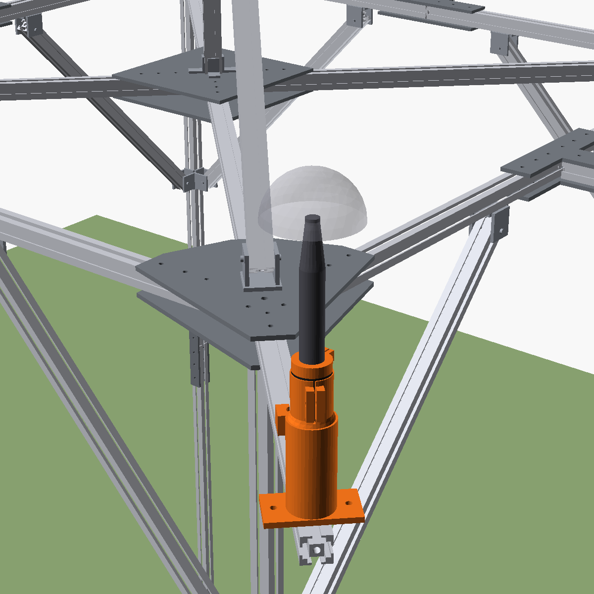
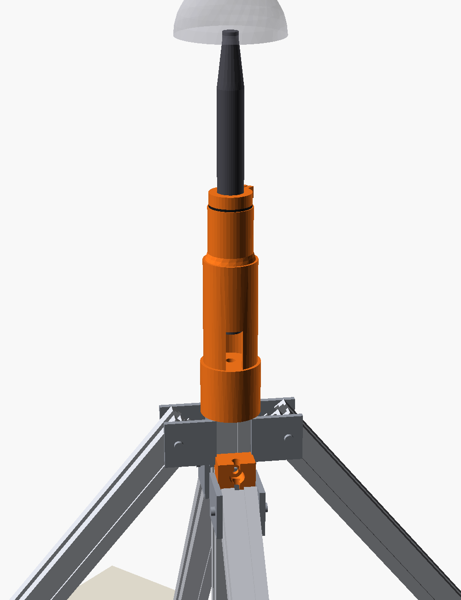
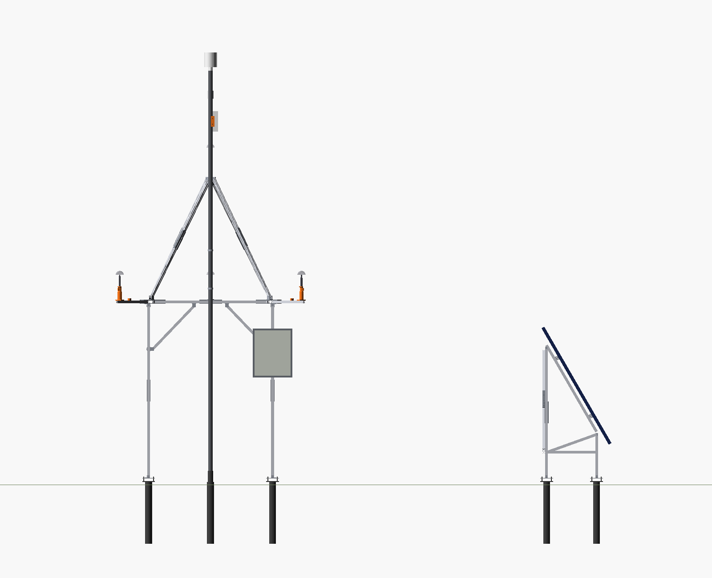
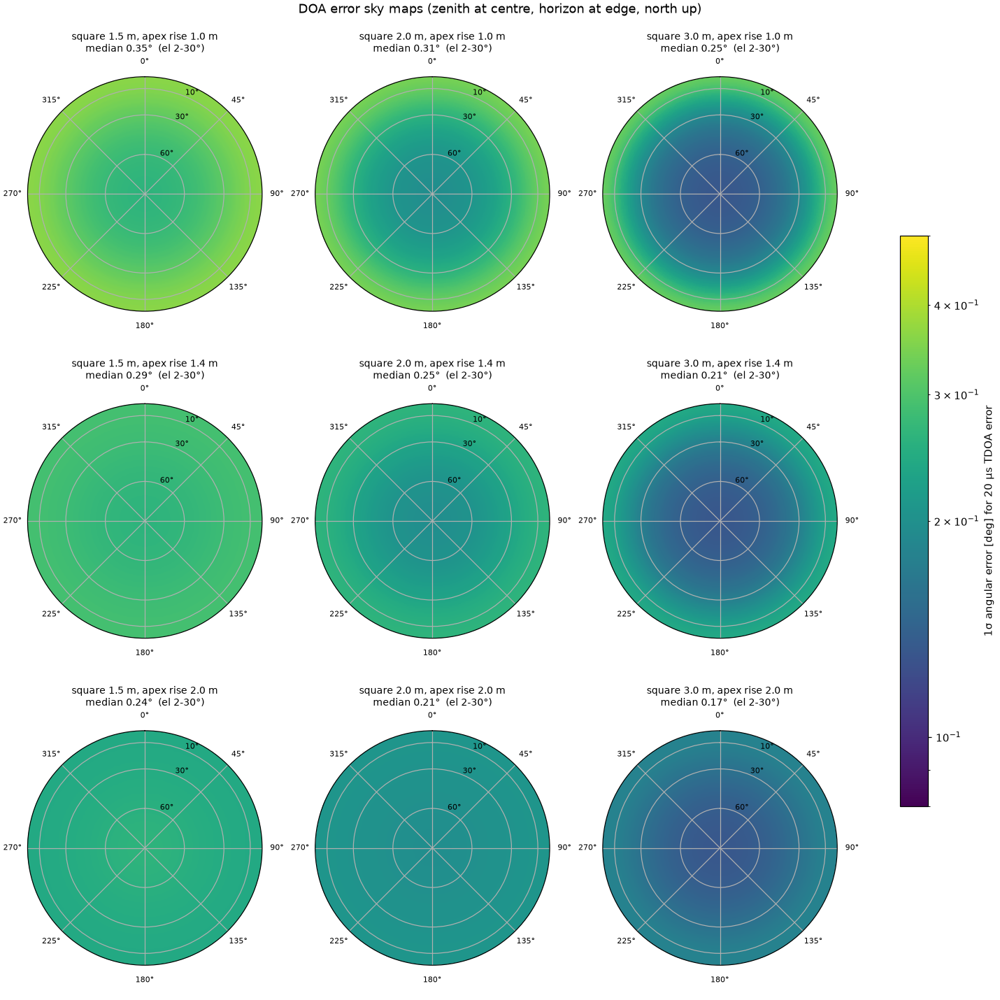
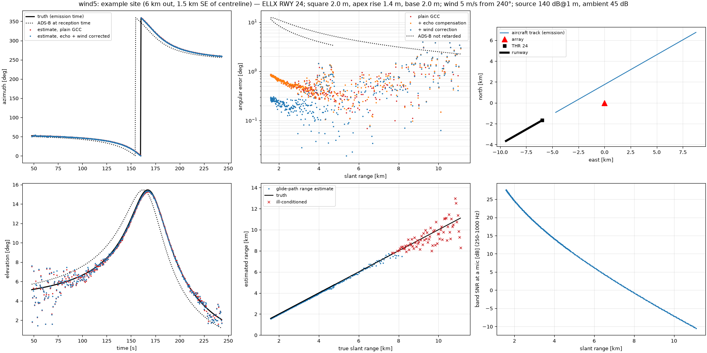

# Acoustic aircraft-tracking array

A parametric mechanical design and simulation toolkit for a garden microphone array. The array tracks aircraft on approach to a nearby airport in 3D (azimuth, elevation, and range along the glide path), and the tracks are validated against ADS-B.



## Layout

The array stands on four braced legs, 2 m above the lawn, out of reach of animals. Its five mics form a pyramid, and all of them point straight up in identical printed holders:

- **Base mics:** four, at the corners of a 2.0 m square, 2.31 m above the ground.
- **Apex mic:** one, on a central mast, 1.4 m above the base mics (3.71 m above the ground).
- **Sixth mic (optional):** on a mid-side outrigger. It needs no frame changes.

An ultrasonic wind sensor, a Wi-Fi bridge and a sky camera sit on a separate pole on the west side. The solar panels are on their own low ground stand, 3 m south of the array.

| File | What it does |
|---|---|
| `array_params.py` | **Single source of truth.** Every dimension is a `Params` field. The script derives the geometry and writes the mic coordinate file. |
| `array_model.py` | CadQuery model. Exports the STEP assembly, STLs of the printed parts, DXFs of the plates, the BOM and the renders. |
| `doa_analysis.py` | Cramér–Rao sky maps of the DOA error caused by timing error. Compares square sizes and apex heights, and checks systematic errors. |
| `tracking_sim.py` | End-to-end simulation of an ILS approach: synthesised mic signals → GCC-PHAT → DOA → glide-path range. Uses real ELLX (Luxembourg) runway data. |
| `cost_estimate.py` | Prices the BOM (low/high EUR estimates) and adds the electronics that are not in the CAD model. |

All outputs are regenerated by the scripts:

- `out/array_assembly.step`: full assembly with named, coloured parts.
- `out/stl/`: 3D-printed parts in print orientation.
- `out/plates/*.dxf`: plate drawings. The corner plates are cut to these. For the catalogue plates they are drilling templates.
- `out/bom.csv`: profile cut list, plates, brackets, fasteners, ground screws, solar and power parts.
- `out/cost_estimate.csv`: the BOM with rough price ranges, plus mics, audio interface, computer, ADS-B receiver and network. The full build comes to roughly €3,500–7,200; the wind sensor choice alone spans €250–1,400.
- `out/mic_positions.json` and `.csv`: mic acoustic centres in metres, for the tracking software.
- `out/analysis/`: sky maps, error-vs-elevation plots and tracking simulation plots.
- `out/render/`: preview images.

## Coordinate system

- The origin is the centre of the base square, **at ground level**.
- x points east, y north, z up.
- The square's sides run along x and y, so the base mics sit on the diagonals: NE, SE, SW and NW.
- Set the array up with +y pointing to **true** north, or measure its heading and rotate the coordinates.

The JSON file includes a hash of the parameters that generated it.

## Running

```bash
python -m venv .venv && .venv/bin/pip install -r requirements.txt
.venv/bin/python array_model.py                      # CAD, BOM, mic file, renders
.venv/bin/python array_model.py --set square_side=2500 --set profile=4040
.venv/bin/python doa_analysis.py --sigma-us 20
.venv/bin/python cost_estimate.py                    # after array_model.py
.venv/bin/python tracking_sim.py --tag nominal                       # built-in example site
.venv/bin/python tracking_sim.py --wind-speed 5 --wind-from 240 --tag wind5
.venv/bin/python tracking_sim.py --site my_site.json --runway 24     # your own site
```

A site file looks like `{"name": "...", "lat": 49.7, "lon": 6.3, "ground_elev_m": 300}`. Results for a `--site` file go to `out_local/`, which is git-ignored. `site_local.json` is ignored too, so you can keep your own location out of the repository.

The renders need `openscad` on your PATH. Every other step runs on Python alone.

## Mechanical design

- **Frame:** 3030 aluminium extrusion, switchable to 4040. The base is four diagonal arms from a central hub to the corner nodes, plus a perimeter square. Each side of the square comes in two halves joined at a mid-side node.
- **Legs:** one under each corner node, each 1.92 m tall and spliced in two.
  - Each leg has two pinned knee braces.
  - Each leg stands on a 140 mm base plate with four M10 levelling studs, on a 76 mm ground screw. No concrete is needed.
- **Outriggers:** these continue the diagonals 450 mm past each corner node. A base mic holder bolts flat onto each outrigger end. No leg, strut or brace is near a capsule.
- **Mast and struts:** the mast stands on the hub, braced by four struts from the corner nodes. There are no guy lines. The struts are pinned at staggered heights on the mast, so neighbouring joints don't clash.
- **Plates and joints (`plates = "standard"`, the default):** catalogue parts wherever they fit.
  - The hub, mid-side nodes and splices use catalogue 3030 cross, T and straight joining plates. The leg feet are galvanised steel plates.
  - Only the eight corner plates are laser-cut, because no catalogue plate takes the 45° arm, both sides, the outrigger and the leg.
  - Struts and knee braces end in DIN 71752 M8 fork heads, screwed into the tapped profile ends. They pin to lugs made from 60 mm pieces of 50×50×5 aluminium T-section.
  - `plates = "custom"` switches back to laser-cut plates and bent clevis brackets.
- **Transport:** no piece is longer than 1.1 m (the limit is 1.2 m). Longer members are split and joined with dowelled splice plates. The frame needs 44.5 m of profile in total.
- **Repeatability:**
  - Every joint is located by 6 mm dowel pins in reamed H7 holes. Bolts and T-nuts only clamp.
  - At the corner plates, the profiles have jig-drilled holes 20 mm from the joint end.
  - Catalogue plates and lugs have no dowel holes. At first assembly, clamp each one in place, drill and ream through plate and profile with the jig, then number it for that position. Splice and tee dowels sit 30 mm from the profile end.
  - Strut and brace lengths are set once on a jig with the fork heads. Then the jam nuts are locked and the threads paint-marked.
  - No position depends on a slot.
- **Fasteners:** A4 stainless bolts with A2/A4 T-nuts.
- **Mic holders:** printed in ASA. Each mic sits in a TPU or EPDM isolation sleeve, and a printed index collar fixed on the mic sets its axial position. The holder has a cavity for the XLR plug, a side cable exit and a drain. Nothing structural comes within the 90 mm windscreen keep-out.
- **Strain relief:** a printed clip on the outrigger or mast holds each cable, with a slack loop so cable vibration bypasses the mic.
- **Electronics box:** hangs on the outward face of the SW leg, 0.93 m from the nearest mic and reachable from the ground. All cables run in armoured, marten-proof conduit.
- **Pole:** a 48.3 mm tube on its own ground screw, clamped to a stand-off post on the west side, 0.95 m from the nearest mic.
  - The ultrasonic wind sensor sits on top, about 1 m above the apex mic. It has no moving parts, so it adds no mechanical noise.
  - A TP-Link CPE210 Wi-Fi bridge sits 4 m up the pole and faces true south, the same way as the solar panels (`cpe_azimuth`). It is strapped to the pole over a printed ASA saddle (`out/stl/cpe_pole_saddle.stl`). The saddle's side lips key the CPE so it can't twist, and a notch on top marks the boresight. Its 65° beam is wide, so re-aiming by the mark is precise enough.
  - The sky camera clamps lower down the pole.
- **Solar:** two ~200 W panels face true south at a 60° tilt, on a separate ground stand 3 m south of the array.
  - **Why 60°:** for spring-to-autumn use, this tilt gives the best yield in the worst months (March and October).
  - **Why a separate stand:** mounted on the array, 2 m² of panel would act as a sail that rocks the frame and moves the mics. It would also be a large reflector right next to the capsules.
  - **Shading and reflections:** the stand is south of the array, so the array never shades it. The stand is low, with its top edge at 1.74 m, below the mics. The glass faces away from the array, so sound reflected off it goes up and south.
  - **Power:** a 100 Ah LiFePO4 battery and an MPPT controller with low-temperature charge cut-off.

| Base mic | Apex mic |
|---|---|
|  |  |



## Findings

### DOA accuracy from timing error

These figures are from `doa_analysis.py`, using a 20 µs TDOA error (1σ). Approaching aircraft are at 2–30° elevation, which is the band the table covers.

| Square | Apex rise | Median error | Cross-track at 3 km / 5 km |
|---|---|---|---|
| 2.0 m | 1.0 m | 0.31° | 16 / 27 m |
| **2.0 m** | **1.4 m** | **0.25°** | **13 / 22 m** |
| 2.0 m | 2.0 m | 0.21° | 11 / 18 m |
| 3.0 m | 1.4 m | 0.21° | 11 / 19 m |

The square size sets the azimuth accuracy. The apex rise sets the elevation accuracy at low elevations. The defaults are a good balance: going taller or wider gives modest gains for a heavier, harder-to-transport frame.



### Systematic errors are bigger than random ones

| Source | Effect |
|---|---|
| Mic position error of 1 cm per axis | 0.41° median bias (1 cm ≈ 29 µs) |
| 5 m/s crosswind | 0.84° bias at **any** range (≈ w⊥/c) |
| Ignoring sound travel time when matching ADS-B | 2.5–12° error. Compare against the aircraft position at **emission** time. |
| Plane-wave model at 1 km | 0.02°, which is negligible |

So survey the built array, or self-calibrate the mic positions against ADS-B tracks. Also correct for the wind.

### End-to-end tracking simulation

This is from `tracking_sim.py`. The scenario is a real ELLX RWY 24 ILS approach (3° glide slope, 72 m/s), followed from 18 km out to 0.5 km from the threshold. The built-in example site is 6 km out along the approach and 1.5 km to the side of the centreline. Other settings:

- 140 dB @ 1 m source and 45 dB ambient.
- ISO 9613-1 atmospheric absorption.
- Lawn reflection R = 0.7.
- 0.5 s frames.

| Slant range | Elevation | SNR | Error, no wind | Error, 5 m/s wind, uncorrected | Error, 5 m/s wind, corrected |
|---|---|---|---|---|---|
| 1–2 km | 14° | 27 dB | 0.10° | 0.79° | 0.26° |
| 2–3 km | 9° | 22 dB | 0.09° | 0.55° | 0.20° |
| 3–5 km | 5° | 15 dB | 0.15° | 0.44° | 0.20° |
| 5–8 km | 7° | 4 dB | 0.35° | 0.46° | 0.39° |
| 8–12 km | 6° | −6 dB | 0.92° | 1.19° | 1.16° |

All errors are medians.

- **Elevating the array mostly removes the ground-echo problem.**
  - All base mics are at the same height, so their echoes are identical and cancel in the base–base pairs.
  - Only the apex pairs see a differential echo.
  - Echo compensation divides the predicted echo transfer function out of the cross-spectra. The lawn's reflection coefficient is learned from the most coherent frames and then held fixed. It was recovered exactly for R = +0.7, −0.7 and 0, and it never makes a frame worse.
- **Wind is the biggest error source at short range.** Correcting with the anemometer reading removes about two-thirds of the wind bias. The rest is because the sensor sees only part of the path-averaged wind.
- **Beyond ~6 km the noise dominates.** Atmospheric absorption cuts the high frequencies, and the SNR goes below 0 dB. Longer frames or a beamformed detector would help there.
- **Range from the glide-path assumption** has a median error of 37 m (1.4 %) where the line of sight crosses the glide path at a useful angle. Where it doesn't (ill-conditioned frames), the error grows to hundreds of metres. A second array would fix that.



## Assumptions and open items

- **CPE210 dimensions** (224 × 79 × 60 mm) are datasheet values. Check them against your unit before printing the saddle.
- **ECM8000 dimensions** come from retailer listings and are unverified: about 21–22 mm body diameter, 190–197 mm length and a 12.7 mm tip. The nose taper length is estimated. Measure your mics with calipers and set `mic_*` in `array_params.py`.
- **Runway data** (ELLX thresholds, elevations and courses) are from OurAirports. Check them against the current AIP before trusting the absolute results.
- **The real lawn reflection** is frequency-dependent and has to be learned on site. The tracker learns it from loud passes.
- **Catalogue plate sizes** vary by supplier. The model assumes 6 mm plates with arms 30 mm wide; set `plate_thk` to what you buy. Extra holes are drilled per the DXF.
- **T-nut count is slightly high:** the BOM counts T-nuts for every plate hole, including unused optional positions.
- **The simulation leaves out** turbulence-induced decorrelation between mics, frequency-dependent ground impedance, and refraction from wind and temperature gradients.
- **Solar sizing** is for spring to autumn only. Winter yield at a 60° tilt is too low for continuous operation.
