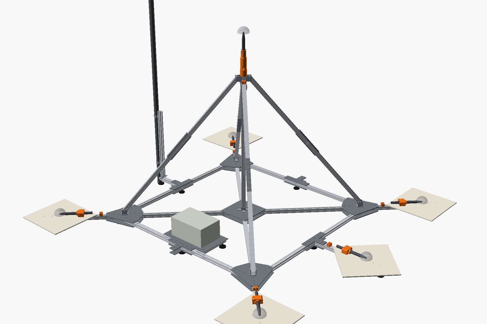
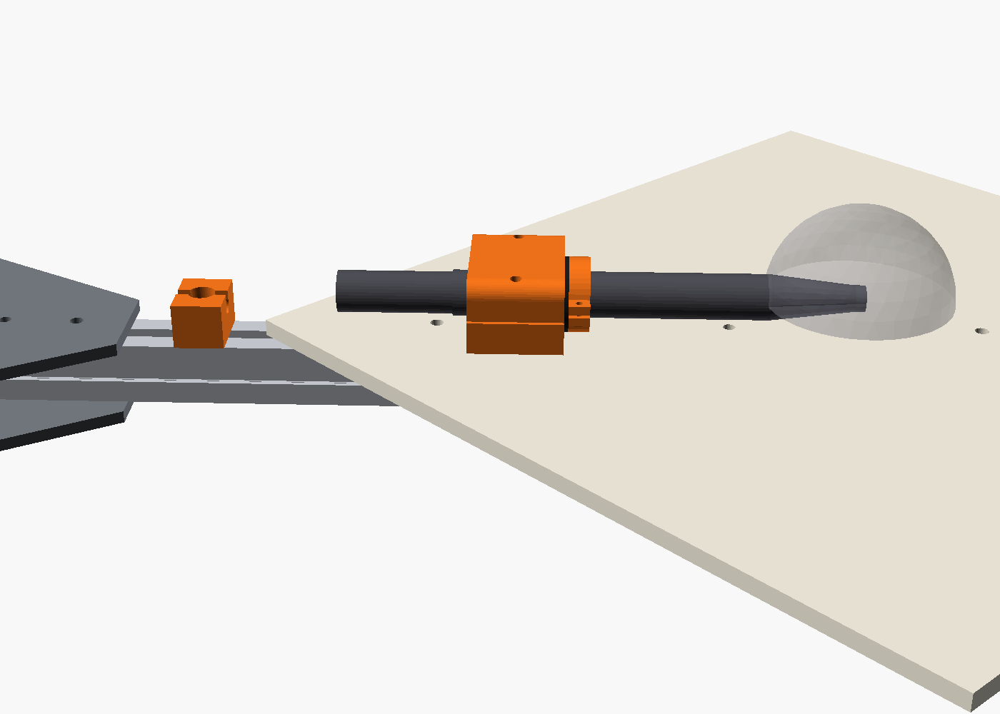
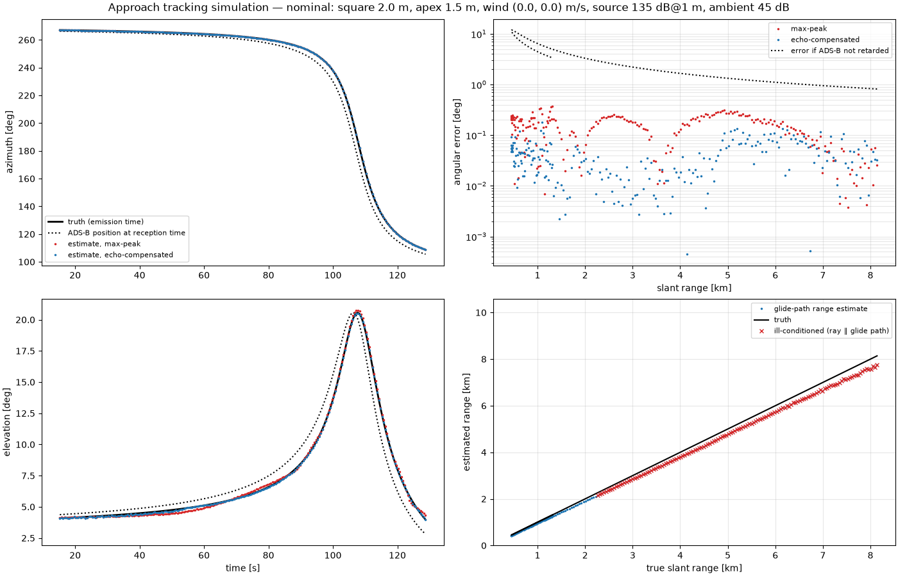

# Acoustic aircraft-tracking array

A parametric mechanical design and simulation toolkit for a garden microphone array. The array tracks aircraft approaching a nearby airport in 3D, and the tracks are validated against ADS-B.



## Layout

The mics form a pyramid. Four mics sit on hard ground-plane boards at the corners of a 2.0 m square. A fifth mic is on a central mast, with its acoustic centre 1.5 m above ground. A sixth ground mic can be added at a mid-side position without changing the frame.

| File | What it does |
|---|---|
| `array_params.py` | **Single source of truth.** Every dimension is a `Params` field. The script derives the geometry and writes the mic coordinate file. |
| `array_model.py` | CadQuery model. Exports the STEP assembly, STLs of the printed parts, DXFs of the plates, the BOM and renders. |
| `doa_analysis.py` | Cramér–Rao sky maps of the DOA error caused by timing error. Compares square sizes and mast heights. |
| `tracking_sim.py` | End-to-end simulation of an ILS approach: synthesised mic signals → GCC-PHAT → DOA → glide-path range. |

Outputs, all regenerated by the scripts:

- `out/array_assembly.step`: full assembly with named, coloured parts.
- `out/stl/`: 3D-printed parts in print orientation.
- `out/plates/*.dxf`: aluminium plates for laser or waterjet cutting.
- `out/bom.csv`: profile cut list, plates, brackets, fasteners, feet and printed parts.
- `out/mic_positions.json` and `.csv`: mic acoustic centres in metres, for the tracking software.
- `out/analysis/`: sky maps, error-vs-elevation plots and tracking simulation plots.
- `out/render/`: preview images.

## Coordinate system

- The origin is the centre of the base square at nominal ground level.
- x points east, y north, z up.
- The square's sides run along x and y, so the ground mics sit on the diagonals: NE, SE, SW and NW.

The JSON file includes a hash of the parameters that generated it.

## Running

```bash
python -m venv .venv && .venv/bin/pip install -r requirements.txt
.venv/bin/python array_model.py                      # CAD, BOM, mic file, renders
.venv/bin/python array_model.py --set square_side=2500 --set profile=4040
.venv/bin/python doa_analysis.py --sigma-us 20
.venv/bin/python tracking_sim.py --threshold 2500,-400 --heading 90 --wind 0,5
```

The renders need `openscad` on your PATH. Every other step runs on Python alone.

## Mechanical design

- **Frame:** 3030 aluminium extrusion, switchable to 4040. The base is four diagonal arms from a central hub to the corner nodes, plus a perimeter square. Each side of the square comes in two halves joined at a mid-side node.
- **Outriggers:** these continue the diagonals 450 mm past each corner node and carry the mic boards. No strut foot or frame member is near a capsule.
- **Mast and struts:** the mast stands on the hub. Four struts run from the corner nodes to the mast top. Each strut ends in a clevis with an 8 mm pin, so it assembles without tools.
- **Struts are staggered:** the struts are fixed 50 mm apart in height on the mast, so neighbouring clevises don't clash.
- **Transport:** the longest piece is the 1144 mm mast. The struts (~1.37 m pin to pin) are split in two with dowelled splice plates.
- **Repeatability:**
  - Every profile has a jig-drilled H7 through-hole 20 mm from each joint end.
  - The plates carry matching reamed holes and 6 mm dowel pins. Bolts and T-nuts only clamp.
  - Strut lengths are set by drilled pin holes.
  - No position depends on a slot.
- **Fasteners:** A4 stainless bolts with A2/A4 T-nuts.
- **Ground mics:** each mic lies horizontally with its axis 16 mm above a 400 mm HPL board, tip pointing outward. This boundary mounting keeps the board reflection in phase up to about 5 kHz.
- **Apex mic:** it points straight up from a printed holder on the mast top. The holder has a cavity for the XLR plug, a side cable exit and a drain.
- **Isolation:** each mic sits in a TPU or EPDM sleeve inside a printed clamp. A printed index collar, fixed on each mic, sets its axial position.
- **Windscreen clearance:** nothing structural comes within the 90 mm windscreen keep-out.
- **Strain relief:** a printed clip on the outrigger or mast, with a slack loop so cable vibration bypasses the mic.
- **Electronics box:** on the south mid-side, about 1.1 m from the nearest mic.
- **Wi-Fi/camera pole:** clamped to a short post on the west mid-side.

| Ground mic | Apex mic |
|---|---|
|  |  |

## Findings

### DOA accuracy from timing error

These figures are from `doa_analysis.py`, using a 20 µs TDOA error (1σ). Approaching aircraft are at 2–30° elevation, which is the band the table covers.

| Square | Apex | Median error | Cross-track at 3 km / 5 km |
|---|---|---|---|
| 2.0 m | 1.0 m | 0.32° | 17 / 28 m |
| **2.0 m** | **1.5 m** | **0.25°** | **13 / 22 m** |
| 2.0 m | 2.5 m | 0.19° | 10 / 17 m |
| 3.0 m | 1.5 m | 0.21° | 11 / 18 m |

The square size sets the azimuth accuracy. The mast height sets the elevation accuracy at low elevations. The defaults (2.0 m square, 1.5 m apex) are a good balance. Going higher means a spliced mast, and the gains are modest.


### Systematic errors are bigger than random ones

| Source | Effect |
|---|---|
| Mic position error of 1 cm per axis | 0.4° median bias (1 cm ≈ 29 µs) |
| 5 m/s crosswind | 0.84° bias at **any** range (≈ w⊥/c). Confirmed in simulation. |
| Ignoring sound travel time when matching ADS-B | 1–8° error (3–25 s delay). Compare against the aircraft position at emission time. |
| Plane-wave model at 1 km | 0.025°, which is negligible |

So survey the built array, or self-calibrate the mic positions against ADS-B tracks. Also estimate or measure the wind.

### End-to-end tracking simulation

This is from `tracking_sim.py`. The scenario is an ILS 3° approach passing 400 m south of the array, with a 135 dB@1 m source and 45 dB ambient noise.

- **Apex ground echo:** the echo from the ground under the apex mic arrives 0.6–2 ms after the direct sound. It biases elevation by about 0.2°, and picking the "earliest peak" doesn't help.
- **Echo compensation fixes it:** dividing the predicted echo transfer function out of the cross-spectra brings the median error to **0.01–0.07°**. The reflection coefficient is fitted per frame. This also works when the echo is phase-inverted.
- **Range from the glide-path assumption:** with the aircraft 20 m / 10 m off the ideal path, the median error is about 5 %. That only holds where the line of sight crosses the glide path at a useful angle, roughly abeam the array. Further out it degrades to hundreds of metres. A second array is needed for range there.
- **Quiet aircraft:** with a 125 dB source and 50 dB ambient, tracking holds to about 5 km (0.05° median). It degrades below 0 dB SNR.



## Assumptions and open items

- **ECM8000 dimensions** come from retailer listings and are unverified: about 21–22 mm body diameter, 190–197 mm length and a 12.7 mm tip. The nose taper length is estimated. Measure your mics with calipers and set `mic_*` in `array_params.py`.
- **Ground boards** sit on the outriggers, 78 mm above the ground. The reflection off the real ground below the board stays in phase for aircraft elevations up to 30° and frequencies up to about 1.8 kHz. Lower `foot_height` to improve this.
- **Clevis brackets** are custom bent plate. The model shows their envelope only.
- **The BOM counts T-nuts** for every plate hole, including unused optional positions. The fastener totals are therefore slightly high.
- **The simulation leaves out** atmospheric absorption, turbulence-induced decorrelation between mics, and frequency-dependent ground impedance.
- **The runway geometry in the simulation is a placeholder.** Set `--threshold` and `--heading` for the real airport.
